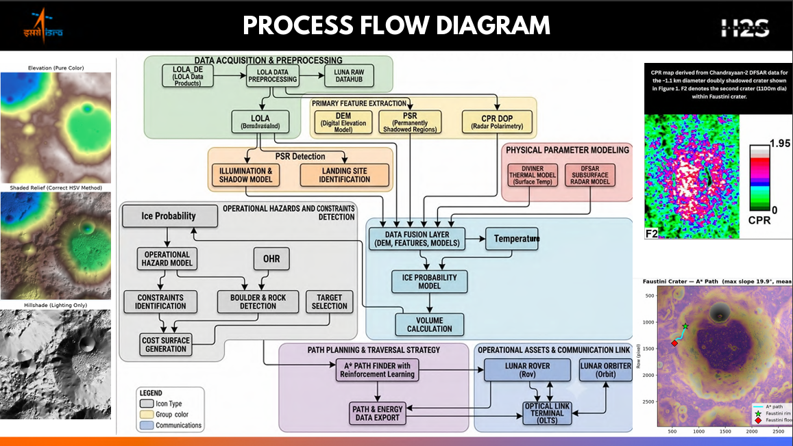
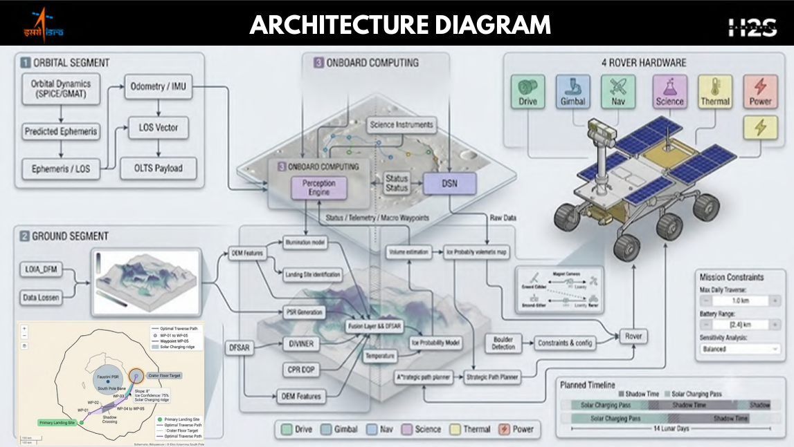
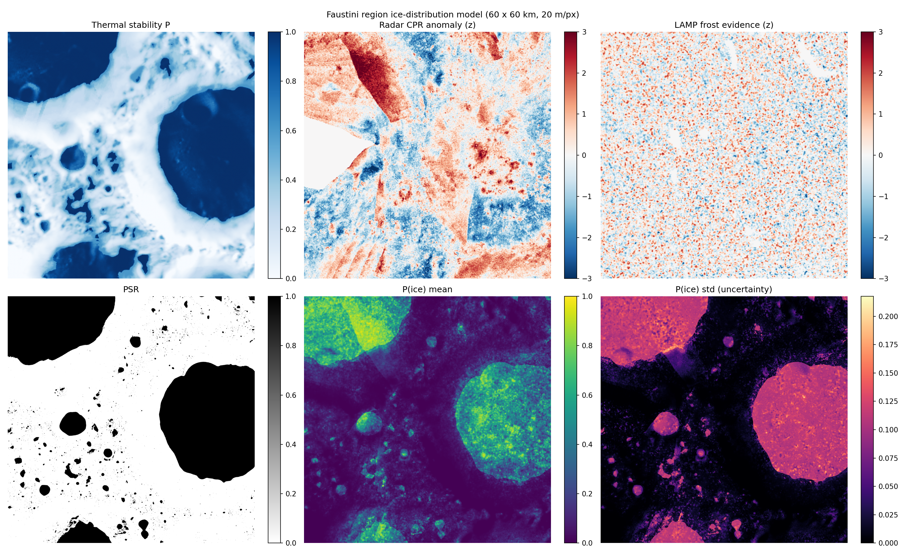
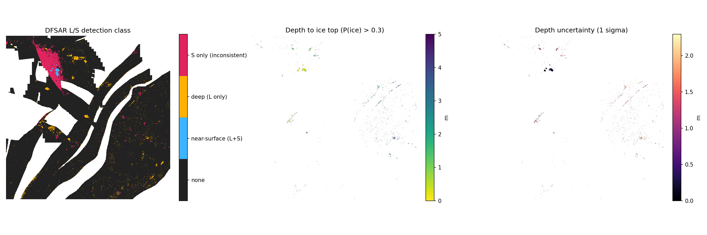

# Lunar PSR Rover — Chandrayaan-2 DFSAR Ice Detection & Traverse Design

**Hackathon:** ISRO Build-a-thon Hackathon 2026 — Chandrayaan-2 Lunar South Polar Exploration Challenge
**Team:** <!-- FILL: your team name -->
**Status:** In progress. The ice-distribution model and the A* path planner are implemented. RL, simulation, and OHRC are planned.

This project uses Chandrayaan-2 DFSAR dual-frequency radar polarimetry to map subsurface lunar ice. It does these tasks:

- It estimates the volume of the subsurface ice.
- It selects a safe landing site near a doubly shadowed crater in the Faustini PSR.
- It calculates an optimal rover traverse path within the power limits.

---

## Problem Statement

The lunar South Pole has **doubly shadowed craters**. These are craters in permanently shadowed
regions (PSRs). In these craters, temperatures decrease to −230 °C, and water ice can have collected over
billions of years. Future ISRO lunar missions must find these deposits and design a safe rover path to them.

This project addresses all five objectives in the problem statement:

1. Map the subsurface ice with dual-frequency (L/S-band) DFSAR polarimetric depth discrimination.
2. Make a fused map of terrain + ice probability from DEM, OHRC, radar, and thermal inputs.
3. Estimate the subsurface ice volume in the top ~5 m of regolith with a dielectric mixing model.
4. Calculate a safe, energy-efficient rover traverse with A* and a PPO reinforcement learning agent.
5. Simulate the Rover ↔ OLTS ↔ Orbiter communication and power chain to validate the waypoints.

---

## System Architecture


Two primary input streams merge at a Fusion Layer. The output of this layer then drives ice estimation, cost mapping, and path planning, in that sequence.





---

## Repository Structure

```
ISRO-BAH-26/
├── download_and_clip.py      # LOLA 20 m DEM crop around Faustini -> lunar_south_pole_full.npy + _meta.json
├── ice_data.py               # Streams/warps all evidence layers (PSR, Diviner, Mini-RF, LAMP, DFSAR) onto DEM grid
├── dfsar.py                  # DFSAR polarimetry (CPR/DOP from SLC) + L/S dual-band depth-to-ice inversion
├── ice_model.py              # Bayesian ice-probability fusion, depth maps, volume estimate
├── cost_map.py               # Slope-based traversability cost map (backend)
├── path_planner.py           # A* rover traverse (frontend, uses config.json)
├── landing_site.py           # Landing-site suitability prototype (slope + illumination)
├── all_maps.py               # Visualise DEM-derived layers
├── config.json               # Start/goal/centre coordinates, DEM URL, slope limit
├── constraints.json          # Rover physical + mission constraints
├── scripts/                  # Exploration: diagnostic.py (slope/roughness stats), height_map.py
├── tests/test_dfsar.py       # Synthetic tests for polarimetry + depth inversion
├── Final_presentation/       # Pitch deck + process_flow.png / architecture.png
├── results/                  # Committed snapshot of model figures + volume JSON
├── data/raw/                 # DFSAR downloads (git-ignored)
├── data/processed/           # Layers warped to DEM grid (git-ignored, regenerate with ice_data.py)
└── outputs/                  # Model outputs (git-ignored)
```

The repository does not contain large data (`*.npy`, `*.tif`, `outputs/`, `data/`). To make the data again, use the commands below.

---

## Current Results — Faustini, 60 × 60 km @ 20 m

| Metric | Value |
| --- | --- |
| Mean P(ice) inside PSR / outside | 0.52 / 0.06 |
| Area with P(ice) > 0.5 | ~603 km² |
| Expected ice volume, 0–3 m (f_ice 1% / 5% / 10%) | 2.1 × 10⁷ / 1.0 × 10⁸ / 2.1 × 10⁸ m³ |
| Expected ice volume, 3–5 m extrapolated | 1.4 × 10⁷ / 7.0 × 10⁷ / 1.4 × 10⁸ m³ |
| Faustini PSR floor Tmax (Diviner) | median 86 K, 100% < 110 K |
| DFSAR L-band CPR cold-vs-warm shift (SERD-corrected) | Δz = −0.02 (not fused) |
| L/S depth signal significant | No → Diviner depth-to-stability used |

**Comparison with the previous heuristic model** (fixed weights, CPR > 1 threshold, no thermal gate):
- The old model gave P > 0.5 to ~3600 km². Of that area, 61% was in terrain with Tmax > 150 K, where ice cannot survive.
- The new model has 0% of its P > 0.5 area in warm terrain.





All values: [`results/ice_volume_estimate.json`](results/ice_volume_estimate.json).

Ablation: PSR is the dominant term. If you remove it, the high-probability area decreases from 579 to 78 km². Mini-RF CPR adds about 30% to that area. LAMP adds a small quantity.

---

## Documentation

All documents are available at **[avinashistoocool.github.io/ISRO-BAH-26](https://avinashistoocool.github.io/ISRO-BAH-26/)**.

- [**Technical report (PDF)**](docs/ISRO-BAH-26_Technical_Report.pdf): the architecture and all of the mathematics in the code. The report also gives the results and limitations. It includes these topics:
  - the polar stereographic grid and terrain roughness;
  - compact/full-pol CPR and DOP, and the roughness-corrected radar anomaly;
  - the thermal-stability gate, and log-odds evidence fusion with Monte-Carlo weights;
  - the L/S depth-to-ice inversion and the enrichment test;
  - the volume integral, the slope cost map and the A* planner.

  The LaTeX source is in [`docs/ISRO-BAH-26_Technical_Report.tex`](docs/ISRO-BAH-26_Technical_Report.tex).
- [**Pitch deck (PDF)**](Final_presentation/Final_ISRO_pitch.pdf): the hackathon presentation.

---

## How to Run

### Full pipeline (planned)

```bash
# 1. Load LOLA DEM and set up the south pole region
python download_and_clip.py

# 2. Visualise all DEM-derived parameter maps (slope, roughness, PSR boundary, aspect)
python src/all_maps.py

# 3. Compute CPR and DOP rasters from DFSAR data (L-band and S-band separately)
python src/cpr_dop.py --dfsar data/processed/dfsar_L.tif data/processed/dfsar_S.tif

# 4. Run fusion layer — merge DEM, PSR, radar, OHRC, and thermal inputs
python src/fusion.py

# 5. Compute ice probability map and export raster
python src/ice_probability.py

# 6. Estimate subsurface ice volume using dielectric mixing model
python src/ice_volume.py --ice outputs/ice_probability_map.tif

# 7. Build cost map and store as numpy array
python src/cost_map.py

# 8. Run A* + RL path planner
python src/path_planner.py --config config/constraints.json

# 9. Run simulation validation (Rover ↔ OLTS ↔ Orbiter)
python src/simulation.py

# 10. Compute and export path metrics
python src/metrics.py --path outputs/rover_path.geojson
```

---

## Datasets

| Dataset | Source | Purpose |
| --- | --- | --- |
| Chandrayaan-2 DFSAR (L + S band) | Provided by organizers | CPR, DOP — dual-frequency radar ice detection |
| LOLA DEM (LRO) | NASA PDS | Elevation, slope, roughness, PSR generation |
| Chandrayaan-2 OHRC | ISRO PRADAN | Crater maps, boulder identification, surface texture |
| LRO Diviner thermal | NASA PDS | Temperature map, illumination fraction per pixel |
| LRO LROC NAC | NASA PDS | Surface texture cross-validation |
| ShadowCam (KPLO) | NASA/KARI | PSR floor imaging |

> For the download instructions of the public datasets, refer to `data/README.md`.

---

## Methodology

### 1. Data Loading and DEM Preprocessing

All datasets are reprojected to **Lunar South Polar Stereographic** and co-registered spatially.
The terrain derivatives and PSR boundaries come from the LOLA DEM.

```python
import richdem as rd

dem       = rd.LoadGDAL("data/processed/lola_dem.tif")
slope     = rd.TerrainAttribute(dem, attrib='slope_degrees')
roughness = rd.TerrainAttribute(dem, attrib='roughness')
# PSR boundary generated via illumination model from SPICE kernels / Diviner data
```

---

### 2. CPR / DOP Analysis — Dual Frequency

The radar polarimetric parameters are calculated **separately for L-band and S-band** from the DFSAR
Stokes matrix data. This is the primary scientific innovation. L-band penetrates to a depth of ~3 m.
S-band penetrates less deeply (~0.5–1 m). The agreement or disagreement between the bands shows
where in the subsurface column the ice is concentrated.

**Circular Polarization Ratio (CPR) per band:**
```
CPR = σ_same-sense / σ_opposite-sense
```

**Degree of Polarization (DOP) per band:**
```
DOP = sqrt(Q² + U² + V²) / I
```

**Per-band ice masks** (thresholds from the ISRO BAH'26 problem statement):
```python
ice_mask_L = (cpr_L > 1.0) & (dop_L < 0.13)   # L-band: deeper signal (~3 m)
ice_mask_S = (cpr_S > 1.0) & (dop_S < 0.13)   # S-band: shallower signal (~1 m)
```

**Why dual-band discrimination is better than single-band CPR:**
Surface roughness and rocky/blocky terrain can increase CPR at the two bands
at the same time. Subsurface ice at depth increases CPR in L-band, but
not in S-band, because S-band cannot get to that depth. The result is a frequency-dependent signature that
surface roughness does not make. DOP < 0.13 also helps to discriminate volume
scattering (ice) from surface scattering (rocks).

---

### 3. Fusion Layer

The fusion layer merges three information streams into a single fused raster. All downstream
modules use this raster:

```python
fused = {
    "dem_geometry":     slope, roughness, aspect,          # from LOLA DEM
    "psr_constraints":  psr_mask, illumination_fraction,   # from PSR generator + Diviner
    "radar_likelihood": cpr_L, cpr_S, dop_L, dop_S,       # from CPR/DOP analysis
    "ohrc_hazards":     crater_density, boulder_map,       # from crater_boulder.py
    "thermal":          temperature_map                    # from Diviner
}
```

---

### 4. Ice Detection and Volume Estimation

#### 4a. Dual-Band Depth Classification

The L/S-band agreement puts each pixel into a depth regime:

```python
near_surface = ice_mask_L & ice_mask_S      # ice within S-band reach (~0–1 m)
deep_only    = ice_mask_L & (~ice_mask_S)   # ice in L-band only (~1–3 m)
no_detection = ~ice_mask_L                  # no ice signal in either band
```

#### 4b. Dielectric Mixing Model

A two-component Maxwell-Garnett mixing model changes the permittivity of each pixel into the ice
volume fraction:

```
ε_mix = (1 − f_ice) × ε_dry_regolith + f_ice × ε_ice
```

Where:
- `ε_dry_regolith` ≈ 2.7 (lunar regolith baseline)
- `ε_ice` ≈ 3.1 (water ice at radar frequencies)
- `f_ice` = ice volume fraction (solved for each pixel)

The temperature from LRO Diviner gives a cross-check. Ice is thermally stable only at
temperatures below ~110 K. Thus, the expected detection zone is limited to pixels where
Diviner shows sufficiently cold conditions.

#### 4c. Volume Integration

```python
vol_near = near_surface.sum() * pixel_area_m2 * s_band_depth_m * f_ice_near
vol_deep = deep_only.sum()    * pixel_area_m2 * (l_band_depth_m - s_band_depth_m) * f_ice_deep
total_volume_m3 = vol_near + vol_deep
```

> **CAUTION:** Do not use the 3–5 m volume as a direct radar measurement. The L-band DFSAR penetration depth is ~3 m.
> The problem statement specifies integration over the top 5 m. Thus, the 3–5 m part is extrapolated beyond the direct radar sensing depth.
> The results identify this part as extrapolated.

---

### 5. Cost Map

The outputs of the fusion layer, the ice probability raster, the OHRC hazard layer, and the PSR masks are combined
into a single traversability cost array. The array is stored as `.npy`:

```python
cost = (w1 * slope_cost
      + w2 * roughness_cost
      + w3 * illumination_penalty
      + w4 * (1 - ice_probability)
      + w5 * boulder_hazard
      + w6 * psr_boundary_penalty)

# Weights (tunable via constraints.json — see sensitivity analysis in results)
w1, w2, w3, w4, w5, w6 = 0.30, 0.20, 0.20, 0.15, 0.10, 0.05
```

Rover physical constraints (`config/constraints.json`):

```json
{
  "max_slope_deg": 15,
  "max_step_height_m": 0.3,
  "speed_kmh": 0.1,
  "operational_hours_per_day": 10,
  "max_daily_traverse_km": 1.0,
  "battery_range_km": [2, 4],
  "psr_rim_distance_constraint_km": 3.0,
  "min_charging_illumination_pct": 70
}
```

> `psr_rim_distance_constraint_km` is set to **3 km** (not 5 km). Thus, the value stays in the
> 2–4 km battery range with a margin. At 0.1 km/h for 10 operational hours/day, the rover
> moves a net traverse of ~1 km/day (this includes stops and thermal rest periods).

---

### 6. Path Planning

The cost map drives an **A\* planner together with a PPO reinforcement learning agent**.
A\* does the structured grid search. The PPO agent optimises the selection of waypoints and
the positions of the charging stops within the battery and illumination limits.

```python
# A* grid search over cost map
path_astar = astar(cost_map, start=landing_site, goal=target_crater)

# PPO agent state and reward
# State:  [position, battery_level, illumination_fraction, slope_ahead]
# Action: [move_direction, stop_to_charge, advance_to_waypoint]
# Reward: +ice_zones_visited − slope_penalty − energy_consumed − shadow_time
```

The **Target Planner** puts the waypoint objectives in sequence:

1. Solar charging stops on illuminated ridges.
2. Intermediate ice zones with high confidence.
3. The final crater target.

**The landing site selection is an output of the path planning**, not a step before it. The planner
finds the optimal start node that gives the minimum total path cost to the target crater,
within the terrain safety limits. This makes sure that the rover can always get from the selected landing site
to the target with one battery charge.

#### Cost Weight Sensitivity Analysis

We tested two weight configurations to validate the stability of the result:

| Config | w1 slope | w4 ice | Effect |
| --- | --- | --- | --- |
| Safety-first | 0.60 | 0.05 | The path avoids steeper terrain; the route is longer |
| Science-first | 0.15 | 0.50 | The path gives maximum ice zone coverage and accepts mild slopes |
| **Default** | **0.30** | **0.15** | **Balanced — used for the final output** |

<!-- FILL: add one sentence describing which configuration produced a meaningfully different path, once sensitivity runs are complete -->

---

### 7. Simulation Validation — Rover ↔ OLTS ↔ Orbiter

Each waypoint on the final path is validated against the Rover–OLTS–Orbiter communication
and power chain:

```
Rover (position, battery%) ──► OLTS ──► Orbiter (LOS window, pass timing)
```

The output identifies each waypoint where the orbiter LOS and the battery level are both below the
threshold at the same time. This shows a comms/power risk, and the path must change or the rover must stop to charge.

---

### 8. Limitations and Future Work

- **The L-band penetration depth (~3 m)** is less than the 5 m integration scope that
  the problem statement requires. The 3–5 m part of the volume estimate is extrapolated, not
  directly sensed, and it has a higher uncertainty.
- **PPO agent training** started during the hackathon. `notebooks/06_path_planning.ipynb` shows the converged reward curve and the
  trained policy. The full integration with real-time terrain feedback is postponed until after the hackathon.
- **OLTS power budget** (orbital laser power transfer) is a possible future extension.
  It is not in the primary pipeline. A preliminary analysis shows that, at 50 W of
  transmitter power and orbital range, the delivered energy is too small to be important for the mission
  with the current parameters. A higher transmitter power is necessary to make it viable.

---

## Key Results

> The results will be added when the pipeline runs are complete. The placeholders below are marked `[ ]`.

| Metric | Value | Notes |
| --- | --- | --- |      
| Target crater | Doubly shadowed crater, Faustini PSR | Organizer-supplied DFSAR data |
| Study area | <!-- FILL: X km × Y km --> | From DFSAR tile extent |
| PSR floor temperature (Diviner) | <!-- FILL: ~XX K --> | Sanity-check: must be < 110 K for ice stability |
| **Ice zone area** (CPR > 1.0, DOP < 0.13, L-band) | <!-- FILL: X.X ± Y km² --> | Near-surface + deep combined |
| Near-surface ice area (both bands) | <!-- FILL: X.X km² --> | Within S-band sensing depth |
| Deep ice area (L-band only) | <!-- FILL: X.X km² --> | Between S-band limit and ~3 m |
| Peak CPR value observed | <!-- FILL: X.X --> | Highest-confidence ice pixel |
| **Estimated ice volume** (top ~3 m, direct) | <!-- FILL: X.X × 10⁶ m³ ± order of magnitude --> | Maxwell-Garnett model, f_ice from dielectric inversion |
| Estimated ice volume (3–5 m, extrapolated) | <!-- FILL: X.X × 10⁶ m³ --> | Extrapolated beyond radar sensing depth — flagged |
| Ice volume fraction (f_ice, peak pixel) | <!-- FILL: ~X% --> | From dielectric mixing model |
| **Selected landing site** | <!-- FILL: lat °S, lon °E --> | Primary site |
| Landing site illumination fraction | <!-- FILL: XX% of lunar day --> | From Diviner / SPICE |
| Distance from landing site to PSR rim | <!-- FILL: X.X km --> | Must be ≤ 3.0 km |
| Contingency site 1 | <!-- FILL: lat °S, lon °E --> | Ranked 2nd by scoring function |
| Contingency site 2 | <!-- FILL: lat °S, lon °E --> | Ranked 3rd by scoring function |
| **Optimal path length** (landing site → crater) | <!-- FILL: X.X km --> | A*+RL output |
| Estimated traverse duration | <!-- FILL: X days --> | At 1 km/day |
| Max slope on path | <!-- FILL: X.X° --> | Must be < 15° |
| Mean slope on path | <!-- FILL: X.X° --> | |
| Time in shadow (path) | <!-- FILL: X.X hours --> | |
| Solar charging waypoints | <!-- FILL: N --> | Illuminated ridges along route |
| Ice zones visited | <!-- FILL: N --> | High-confidence CPR > 1.0 pixels on path |
| Energy consumed | <!-- FILL: X Wh --> | Estimated from speed + distance |
| Safety score | <!-- FILL: XX% --> | % of path cells below 15° slope threshold |
| Orbiter comms coverage | <!-- FILL: XX% --> | % of waypoints with LOS window |
| **OLTS simulation** (Rover ↔ OLTS ↔ Orbiter) | <!-- FILL: table or link to notebook --> | See `notebooks/07_simulation.ipynb` |

---

## Simulation Waypoint Table

> `simulation.py` adds the values. Fill in the table after you run it.

| Waypoint | Type | Battery % | Orbiter LOS | Comms Window | Status |
| --- | --- | --- | --- | --- | --- |
| WP-01 | Landing site | <!-- FILL --> | <!-- FILL: YES/NO --> | <!-- FILL: X min --> | <!-- FILL: OK/FLAG --> |
| WP-02 | Charging stop | <!-- FILL --> | <!-- FILL --> | <!-- FILL --> | <!-- FILL --> |
| WP-03 | Ice zone | <!-- FILL --> | <!-- FILL --> | <!-- FILL --> | <!-- FILL --> |
| WP-04 | PSR rim crossing | <!-- FILL --> | <!-- FILL --> | <!-- FILL --> | <!-- FILL --> |
| WP-05 | Target crater floor | <!-- FILL --> | <!-- FILL --> | <!-- FILL --> | <!-- FILL --> |

> Add or remove rows so that the number of rows is the same as the number of waypoints in `rover_path.geojson`.

---

## Installation

```bash
git clone https://github.com/<!-- FILL: your-org -->/lunar-psr-rover.git
cd lunar-psr-rover
pip install -r requirements.txt
```

**requirements.txt**
```
numpy
scipy
gdal
rasterio
richdem
shapely
geopandas
networkx
matplotlib
plotly
stable-baselines3
spiceypy
defusedxml
```

---

## Tools and Technologies

| Category | Tools |
| --- | --- |
| GIS and mapping | QGIS, ArcGIS, GDAL, rasterio, geopandas |
| Programming | Python 3.10+ (NumPy, SciPy) |
| Radar processing | MIDAS, custom Python (Stokes → CPR/DOP) |
| Terrain analysis | richdem, PDAL, SPICE kernels (spiceypy) |
| Ice modelling | Custom Maxwell-Garnett dielectric mixing (ice_model.py) |
| Path planning | networkx (A*), stable-baselines3 (PPO reinforcement learning) |
| Visualisation | QGIS, matplotlib, plotly, PyVista |

---

## Team

| Name | Role |
| --- | --- |
| Avinash Chandra Gupta| Team lead, Nakshatra |
| Subodh | Radar processing — CPR/DOP (L and S band), DFSAR Stokes pipeline |
| Aditya | Ice detection, dielectric mixing model, volume estimation |
| Avinash | Path planning, A* implementation, cost map |
| Esha | PPO RL agent, target planner, simulation validation |

---

## References

- Sinha, Bharti, Acharyya, Mishra, Srivastava & Bhardwaj (2026) — Doubly shadowed crater
  subsurface ice detection via Chandrayaan-2 DFSAR, *NPJ* —
  <!-- FILL: confirm DOI before submission -->
- Fa, Z. & Cai, Y. (2011) — Polarimetric radar scattering model from lunar regolith with
  embedded ice inclusions, *Journal of Geophysical Research: Planets*
- Spudis, P.D. et al. (2013) — Evidence for water ice on the Moon,
  *Journal of Geophysical Research: Planets*
- Lemelin, M. et al. (2021) — Haworth crater volatile inventory estimate —
  <!-- FILL: confirm full citation -->
- Durga Prasad, K. et al. (2024) — Chandrayaan-3 alternate landing site: pre-landing
  characterisation, *Current Science*, 126, 774
- LRO LOLA Science Team — Lunar topographic model, NASA PDS
- Noda, H. et al. — Illumination conditions at lunar south polar regions
- Chandrayaan-2 DFSAR instrument description — ISRO

---

## Citing

If you use this work, please cite it with the metadata in [`CITATION.cff`](CITATION.cff) (GitHub shows a "Cite this repository" button). The Zenodo metadata is in [`.zenodo.json`](.zenodo.json).

---

## License

MIT License — refer to `LICENSE` for details.

---

*Submitted for the ISRO Build-a-thon Hackathon 2026 — Chandrayaan-2 Lunar South Polar Exploration Challenge*
