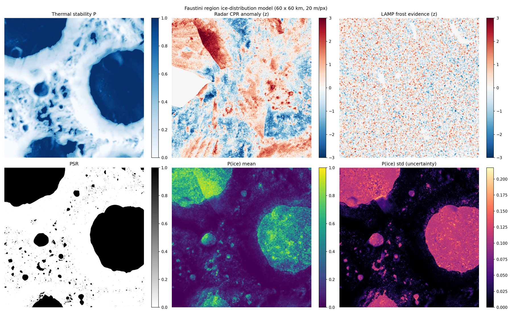
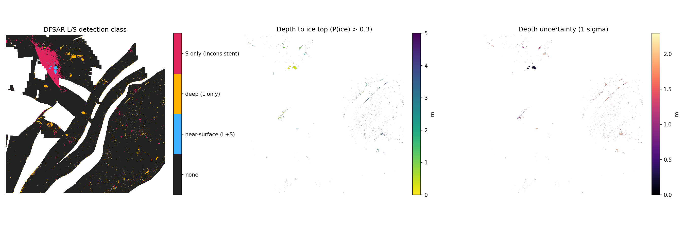

# ISRO-BAH-26

Subsurface water-ice mapping and rover traverse planning at the lunar south pole, using
Chandrayaan-2 DFSAR radar together with public LRO data. Built by team **Nakshatra** for the
ISRO Bharatiya Antariksh Hackathon 2026.

- [**Technical report (PDF)**](ISRO-BAH-26_Technical_Report.pdf): architecture, every formula
  used in the code with its real constants, results and limitations.
- [**Pitch deck (PDF)**](Final_ISRO_pitch.pdf): the hackathon presentation.
- [**Source code**](https://github.com/Avinashistoocool/ISRO-BAH-26)

## What it does

The study area is a 60 × 60 km window around Faustini crater on the LOLA 20 m south-polar DEM.

1. **Data.** `download_and_clip.py` streams the DEM crop. `ice_data.py` resamples the LOLA PSR
   map, Diviner maximum temperature and depth to ice stability, Mini-RF S-band CPR, LAMP
   Lyman-α ratio and the DFSAR L-band Level-3C mosaics onto the same grid.
2. **Polarimetry.** `dfsar.py` computes CPR and DOP from compact-pol or full-pol data.
3. **Ice probability.** `ice_model.py` fuses roughness-corrected radar anomalies, LAMP and PSR
   evidence in log-odds space, multiplies by a thermal-stability term
   (σ((110 K − Tmax)/5 K)) and propagates weight uncertainty by Monte Carlo.
4. **Depth to ice.** The L/S CPR excess ratio is inverted for the depth of the ice top with a
   two-layer attenuation model (e-folding depths 0.5 m for S, 1.5 m for L), calibrated on cold
   pixels and accepted only if it passes a cold-versus-warm enrichment test.
5. **Volume.** Expected ice volume in the top 5 m, split into the directly sensed 0–3 m and the
   extrapolated 3–5 m, for ice fractions of 1, 5 and 10 %.
6. **Traverse.** `cost_map.py` builds a slope cost map and `path_planner.py` runs 8-connected A*
   with an octile heuristic from the Faustini rim to the floor.

## Results (Faustini, 20 m)

| Metric | Value |
| --- | --- |
| Mean P(ice) inside / outside PSR | 0.52 / 0.06 |
| Area with P(ice) > 0.5 | 603 km² |
| Expected ice volume, 0–3 m (f = 1 / 5 / 10 %) | 2.1 × 10⁷ / 1.1 × 10⁸ / 2.1 × 10⁸ m³ |
| Expected ice volume, 3–5 m, extrapolated | 1.4 × 10⁷ / 7.1 × 10⁷ / 1.4 × 10⁸ m³ |
| L/S depth signal significant | No (Diviner depth to stability used) |

## Status

The ice model, depth inversion, volume estimate and A* planner are implemented; the polarimetry
and depth inversion are covered by synthetic tests. The weighted multi-term cost map, PPO agent, rover–relay–orbiter simulation and
OHRC hazards are planned; see the limitations section of the report.

## Citing

If you use this work, please cite it using the metadata in
[`CITATION.cff`](https://github.com/Avinashistoocool/ISRO-BAH-26/blob/main/CITATION.cff).
