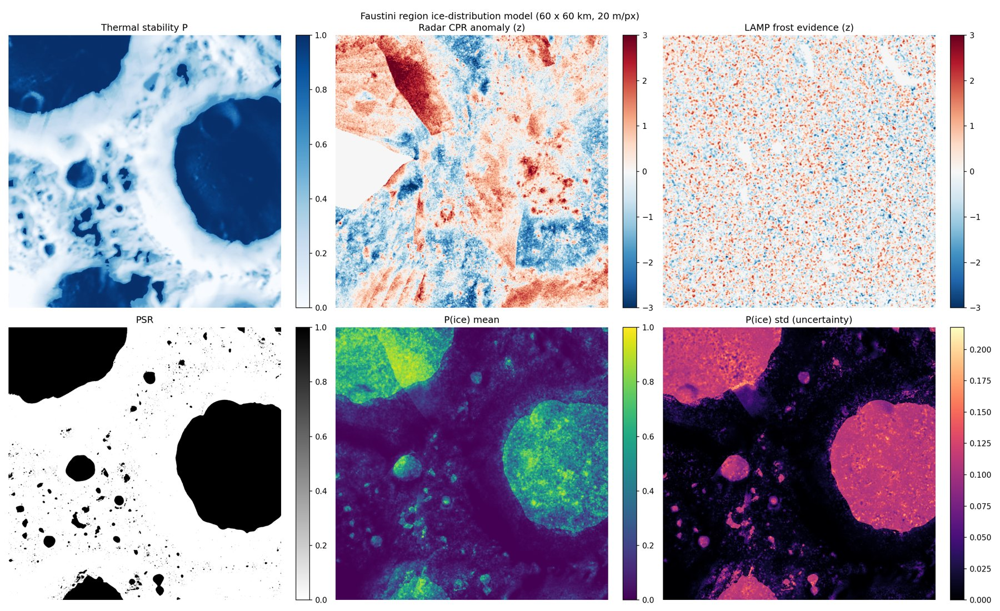
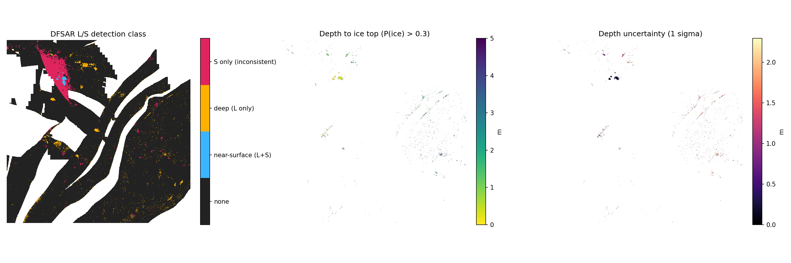

# ISRO-BAH-26

This project maps subsurface water ice and plans a rover traverse at the lunar south pole.
It uses Chandrayaan-2 DFSAR radar together with public LRO data. Team **Nakshatra** made it for the
ISRO Bharatiya Antariksh Hackathon 2026.

- [**Technical report (PDF)**](ISRO-BAH-26_Technical_Report.pdf): the architecture, each formula
  in the code with its real constants, the results and the limitations.
- [**Pitch deck (PDF)**](Final_ISRO_pitch.pdf): the hackathon presentation.
- [**Source code**](https://github.com/Avinashistoocool/ISRO-BAH-26)

## Functions

The study area is a 60 × 60 km window around Faustini crater on the LOLA 20 m south-polar DEM.

1. **Data.** `download_and_clip.py` streams the DEM crop. `ice_data.py` resamples these layers onto the same grid:
   the LOLA PSR map, the Diviner maximum temperature and depth to ice stability, the Mini-RF S-band CPR, the LAMP
   Lyman-α ratio and the DFSAR L-band Level-3C mosaics.
2. **Polarimetry.** `dfsar.py` calculates CPR and DOP from compact-pol or full-pol data.
3. **Ice probability.** `ice_model.py` fuses roughness-corrected radar anomalies, LAMP and PSR
   evidence in log-odds space. It multiplies the result by a thermal-stability term
   (σ((110 K − Tmax)/5 K)). It propagates the weight uncertainty with Monte Carlo.
4. **Depth to ice.** A two-layer attenuation model (e-folding depths 0.5 m for S, 1.5 m for L) inverts the L/S CPR excess ratio
   for the depth of the top of the ice. The model is calibrated on cold
   pixels. The result is accepted only if it passes a cold-versus-warm enrichment test.
5. **Volume.** The expected ice volume in the top 5 m, for ice fractions of 1, 5 and 10 %. The volume has two parts:
   the directly sensed 0–3 m and the extrapolated 3–5 m.
6. **Traverse.** `cost_map.py` makes a slope cost map. `path_planner.py` runs 8-connected A*
   with an octile heuristic from the Faustini rim to the floor.

## Results (Faustini, 20 m)

| Metric | Value |
| --- | --- |
| Mean P(ice) inside / outside PSR | 0.52 / 0.06 |
| Area with P(ice) > 0.5 | 603 km² |
| Expected ice volume, 0–3 m (f = 1 / 5 / 10 %) | 2.1 × 10⁷ / 1.1 × 10⁸ / 2.1 × 10⁸ m³ |
| Expected ice volume, 3–5 m, extrapolated | 1.4 × 10⁷ / 7.1 × 10⁷ / 1.4 × 10⁸ m³ |
| L/S depth signal significant | No (the Diviner depth to stability is used) |

## Status

The ice model, the depth inversion, the volume estimate and the A* planner are implemented.
Synthetic tests cover the polarimetry and the depth inversion. These items are planned:

- The weighted multi-term cost map.
- The PPO agent.
- The rover–relay–orbiter simulation.
- The OHRC hazards.

For more data, refer to the limitations section of the report.

## Citing

If you use this work, please cite it with the metadata in
[`CITATION.cff`](https://github.com/Avinashistoocool/ISRO-BAH-26/blob/main/CITATION.cff).
